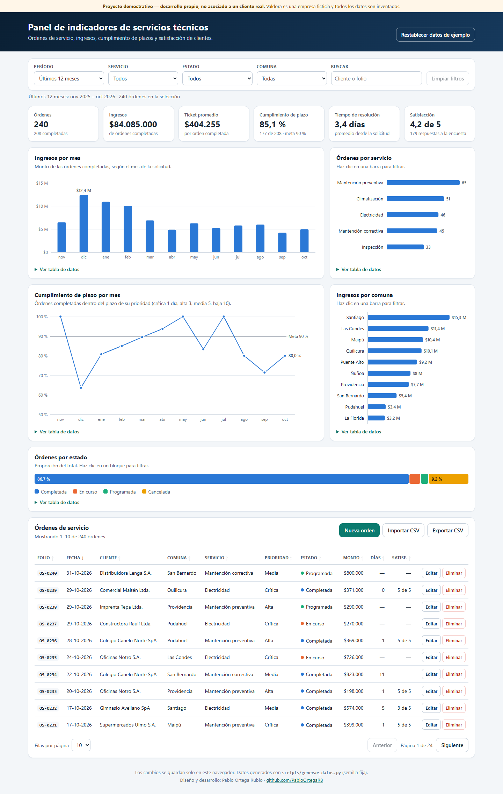
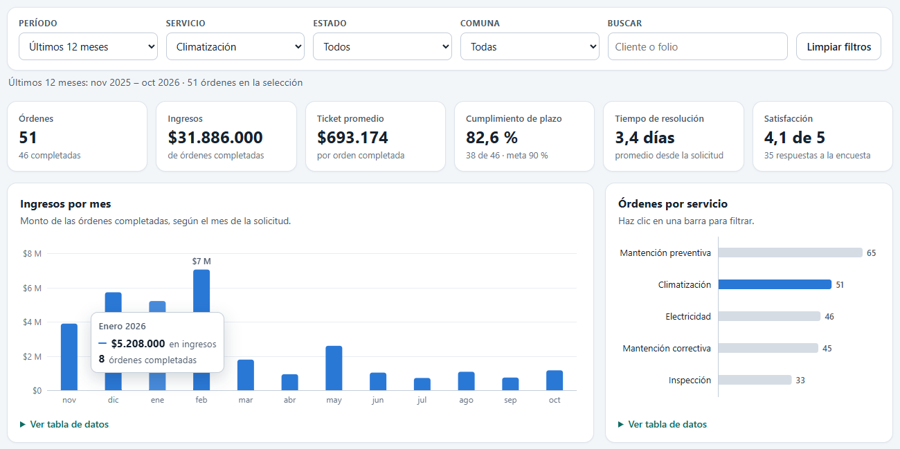
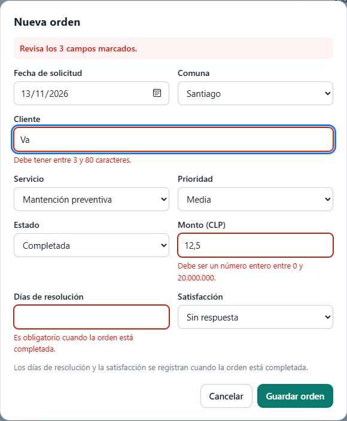
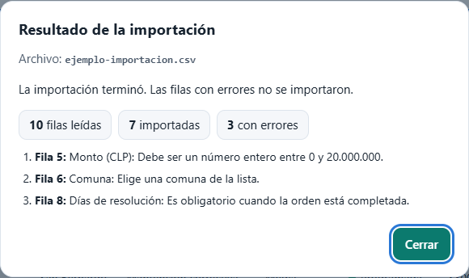
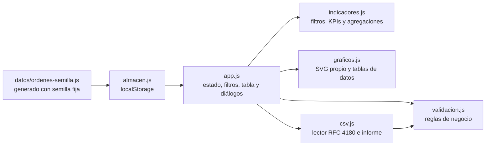
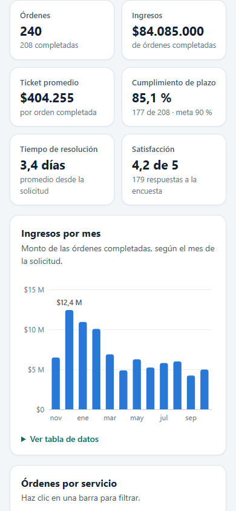
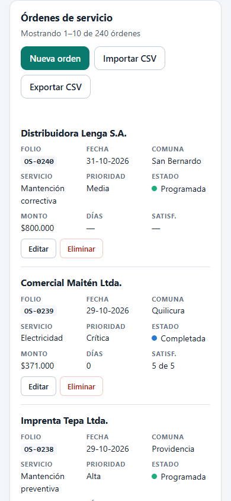
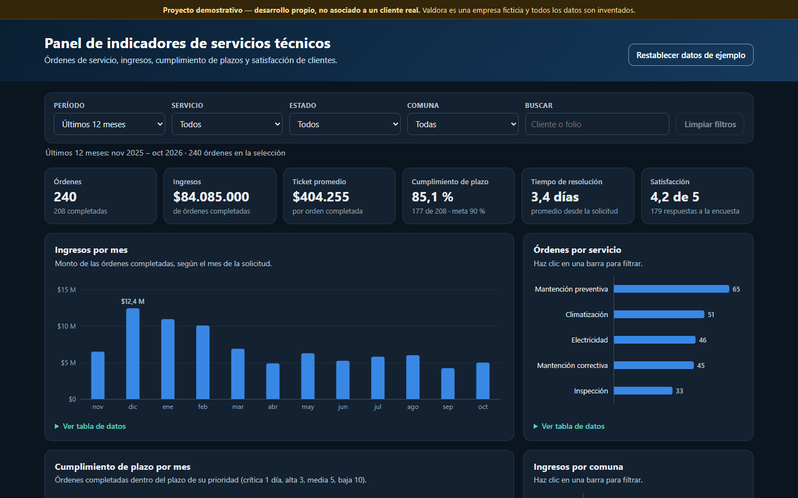

# Panel de indicadores · datos de servicios técnicos

> **Proyecto demostrativo — desarrollo propio, no asociado a un cliente real.**
> «Valdora» es una empresa ficticia. Las 240 órdenes son datos sintéticos generados con una semilla fija.



## Qué problema resuelve

Muchas pymes llevan sus órdenes de servicio en planillas y no ven a tiempo lo importante: cuánto ingresa cada mes, qué servicios se piden más, si se cumplen los plazos comprometidos y cómo evalúan los clientes. Este panel convierte esos registros en indicadores claros. Permite filtrarlos y corregirlos, y sirve de base para **migrar datos desde planillas** con validación fila por fila.

## Funcionalidades

- **6 indicadores:** órdenes, ingresos, ticket promedio, cumplimiento de plazo (meta 90 %), tiempo de resolución y satisfacción.
- **5 gráficos SVG hechos a mano, sin librerías:** columnas, barras clasificadas, línea con meta y barra segmentada. Cada uno tiene tooltip al pasar el puntero y al enfocar con teclado, y una **tabla de datos equivalente**.
- **Filtros en una sola fila:** período (predefinido o rango personalizado), servicio, estado, comuna y búsqueda que ignora mayúsculas y tildes.
- **Filtro cruzado:** un clic en una barra o en un bloque filtra todo el panel. La selección queda resaltada en su contexto.
- **Tabla ordenable y paginada.** En el celular, cada orden se muestra como una ficha.
- **Crear, editar y eliminar** órdenes con validación en español, campos marcados y confirmación antes de borrar.
- **Importación CSV con informe** de las filas rechazadas y el motivo: la base de una migración desde planillas.
- **Exportación CSV lista para Excel en español** (BOM UTF-8 y `;`), con protección contra la **inyección de fórmulas**.
- **Persistencia en el navegador** (`localStorage`). Si el navegador la bloquea, el panel sigue funcionando y lo avisa.
- **Modo oscuro**, navegación por teclado, `aria` en gráficos y controles, y política de seguridad de contenido (CSP).
- **Sin dependencias ni compilación:** funciona abriendo `index.html` o publicado en GitHub Pages.

| Filtro cruzado y tooltip | Validación del formulario | Informe de importación |
|---|---|---|
|  |  |  |

## Arquitectura



```text
index.html                  Página única (CSP, sin recursos externos)
assets/js/nucleo.js         Catálogos y formatos es-CL
assets/js/validacion.js     Reglas compartidas por el formulario y la importación
assets/js/csv.js            Exportación, lector CSV e importación con informe
assets/js/almacen.js        Persistencia local con respaldo en memoria
assets/js/indicadores.js    Funciones puras: filtros, KPIs y agregaciones
assets/js/graficos.js       Columnas, barras, línea y barra segmentada en SVG
assets/js/app.js            Interfaz y eventos
datos/                      Datos de ejemplo y CSV de prueba con errores
scripts/                    Generador de datos y capturas
tests/                      26 pruebas con Playwright y pytest
```

Las reglas de cada campo, las fórmulas de los indicadores y el formato CSV están en el **[diccionario de datos](docs/diccionario-datos.md)**.

## Decisiones de visualización

- **Una sola escala por gráfico.** Ingresos y cumplimiento van en gráficos separados: nunca en un gráfico con dos ejes.
- **Paleta categórica validada** para daltonismo y contraste, en modo claro y oscuro, con un script de validación (ΔE entre colores vecinos ≥ 8). El color sigue al estado: «Cancelada» conserva su color con cualquier filtro.
- **Marcas delgadas y etiquetas selectivas:** se etiqueta el máximo, el último punto y la punta de cada barra. El resto queda en el eje, el tooltip y la tabla de datos.
- **Nada depende solo del color ni del puntero:** leyenda, tablas de datos, foco con teclado y textos alternativos.

## Cómo ejecutarlo

Abre `index.html` en el navegador, o sírvelo localmente:

```bash
python -m http.server 8000      # luego abre http://localhost:8000
```

Los cambios quedan guardados solo en ese navegador. El botón **Restablecer datos de ejemplo** vuelve al estado inicial.

Para regenerar los datos de ejemplo: `python scripts/generar_datos.py`. La semilla es fija, así que el resultado siempre es el mismo.

## Pruebas

```bash
pip install -r requirements-dev.txt
python -m playwright install chromium
pytest
```

**Resultado verificado: 26 pruebas, 26 aprobadas** (13-11-2026, Python 3.11, Playwright con Microsoft Edge). Las pruebas **recalculan los indicadores en Python** a partir de los datos y los comparan con lo que muestra el panel. Si el JavaScript calculara mal, no coincidirían.

| Archivo | Pruebas | Qué cubre |
|---|---|---|
| `test_panel.py` | 14 | Carga sin errores, indicadores vs. cálculo independiente, marcas y tablas de cada gráfico, filtros, filtro cruzado con clic y teclado, períodos, búsqueda sin tildes, estados vacíos, orden y paginación, tooltip, móvil sin desplazamiento horizontal, modo oscuro |
| `test_datos.py` | 12 | Crear con validación y persistencia, reglas de cierre y fecha futura, editar, eliminar con confirmación, exportar CSV, filtros e inyección de fórmulas, importar con informe por fila, columnas faltantes, restablecer, almacenamiento bloqueado, ida y vuelta CSV exacta, lector CSV |

Las capturas se generan con `python scripts/capturas.py`.

| Móvil: indicadores | Móvil: tabla como fichas | Modo oscuro |
|---|---|---|
|  |  |  |

## Limitaciones conocidas

- Los datos viven en el navegador de cada persona. Para varios usuarios haría falta una API y una base de datos, como en el proyecto [`showcase-api-springboot`](https://github.com/PabloOrtegaRB/showcase-api-springboot).
- Sin autenticación: es una demostración.
- La importación acepta hasta 1 MB o 5.000 filas. Para volúmenes mayores convendría procesar el archivo en un servidor.
- Los gráficos son propios para mostrar el oficio. En un proyecto real con muchos reportes, una herramienta como Metabase o Power BI puede convenir más.

## Licencia y autor

Licencia MIT. Diseño y desarrollo: **Pablo Ortega Rubio** — desarrollo de software, datos y automatización · [github.com/PabloOrtegaRB](https://github.com/PabloOrtegaRB)
